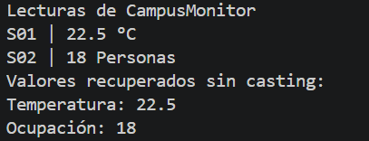

# Universidad Politecnica Salesiana

## Estructura de datos

### Estudiante: Sebastian Arenillas

## 1. Implementación realizada

### Qué representa la clase Lectura<T>.
La Lectura<T> almacena tres datos los cuales vendrian a ser 
idSensor, valor y unidad

### Qué representa T y por qué permite utilizar la misma clase para temperatura y ocupación.
La letra T representa un tipo generico de java y en el codigo se usa para almacenar la temperatura y la ocupacion

### Qué agregaste en App.java
En la clase App se importo la clase lectura y se creo el metodo 
runLectura() para realizar las pruebas, y se crearon dos objetos
para representar la temperatura y la ocupacion

## Captura de pantalla

