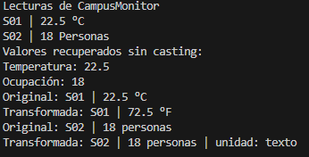

# Universidad Politecnica Salesiana

## Estructura de datos

### Estudiante: Sebastian Arenillas

## 1. Implementación realizada

### Que representa R?
R va a representar el tipo de dato del valor que resulta de la transformacion

### Por que transformar es generico aunque runTransformaciones no lo sea?
EL metodo va a ser generico porque convierte una lectura de tipo T en una nueva lectura de tipo R
mientras runTransformacione no lo es porque utiliza tipos especificos para las conversiones

### Indica que agregaste en Lectura y App
En App se agrego el runTransformaciones el cual convierte de Celsious a Fahrenheit y la 
ocupacion a texto

